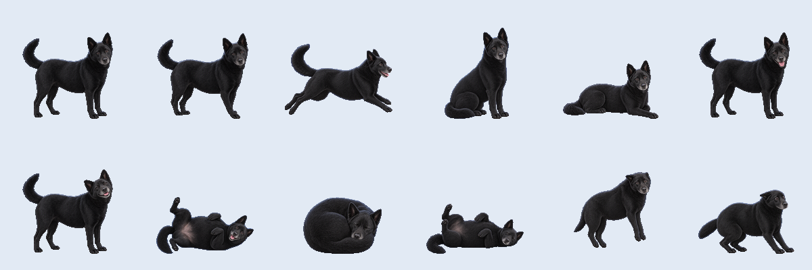

# 小黑桌寵 Black Desktop Pet

小黑是一隻害羞、愛睡、會撒嬌的黑色台灣米克斯，住在你的 Windows 桌面上。
*Xiaohei is a shy, sleepy and cuddly black Taiwanese dog that lives on your Windows desktop.*

目前版本：**V1.0.1**（2026-10-31：走路重做、撒嬌改成開心的樣子、側躺睡和趴下照照片重畫）　動畫示範：[docs/demo.gif](docs/demo.gif)

## 怎麼開

1. 下載整個資料夾（Code → Download ZIP）。解壓縮前先對 ZIP 按右鍵 →「內容」→ 勾選「解除封鎖」。
2. 按兩下 `START_Black.cmd`。不用安裝、不需要系統管理員權限（Windows 10／11 內建的 PowerShell 5.1）。
3. 打不開時，黑色視窗會說明原因並打開 `docs/start_help.txt`；`DIAG_Black.cmd` 是診斷模式。

## 會做什麼

- 站著會呼吸、眨眼、搖尾巴；自己走動、坐下、趴下、打哈欠、歪頭、聞聞地上，偶爾跑一跑。
- 點一下會開心；滑鼠停在身上會撒嬌，一直摸會翻肚子。
- 抓起來拖著走時腳在空中划；甩出去會飛出去、碰到螢幕邊緣彈回來，再滑行停下。
- 沒人理會自己睡覺（四種睡姿），晚上 11 點到早上 6 點自動睡。
- 追滑鼠、叫小黑過來（右下角常駐的小黑頭像點一下也可以）。
- 右鍵選單：心情、睡覺／叫醒、動作、走動、設定（五種尺寸、永遠在最上層、晚上自動睡、沒人理會自己睡）、關於（版本、檢查更新）。

之後會一版一版加上：餵點心、喝水、玩具、換衣服、鬧鐘、番茄鐘、健康提醒、重力模式等。

## 安全性

- 平常不連網路；只有「檢查更新」會連到這個 GitHub 專案，只下載小黑自己新的或改過的檔案（下載前會先問），不刪除任何檔案。
- 不改 Windows 設定、不安裝東西、不需要系統管理員權限，也不會繞過 PowerShell 的安全設定。
- 只寫小黑自己的檔案：`%APPDATA%\BlackPet` 的設定，和出問題時資料夾裡的 `BlackPet_Error_*.txt`。

## 檔案

| 檔案 | 說明 |
|---|---|
| `BlackPet.ps1` | 程式（PowerShell 5.1 + Windows Forms，單一檔案） |
| `START_Black.cmd`、`DIAG_Black.cmd` | 開啟小黑／診斷模式 |
| `pics/` | 39 張圖片（768×768，透明背景） |
| `xiaohei.ico` | 右下角圖示 |
| `docs/` | 打不開時的說明、預覽圖、動畫示範 |
| `使用說明.txt` | 完整使用說明（最上面是每一版的更新） |

> 沒有改到的檔案（GitHub 上顯示較舊的日期或版本）仍是目前版本的一部分，請不要刪除。
